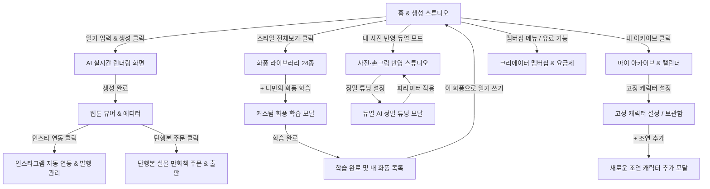

# ToonLog (툰로그) 최종 디자인 시스템 가이드 (Design System Guide)

> **ToonLog**는 소소한 일상 텍스트를 AI 기반 4컷 일상 웹툰으로 변환해주는 크리에이티브 AI 플랫폼입니다. 
> 본 문서는 일관된 브랜드 아이덴티티, 감성적인 비주얼 계층, 컴포넌트 규격 및 유저 인터랙션 원칙을 총망라한 최종 디자인 시스템 명세서입니다.

---

## 1. 브랜드 비전 & 디자인 철학 (Brand Philosophy)

1. **감성적 공감과 기록의 가치 (Emotional Warmth & Archiving)**
   - 딱딱한 생성형 AI 도구가 아닌, 사용자의 오늘 하루와 사소한 감정을 보듬는 "따뜻한 그림일기장" 경험을 지향합니다.
2. **원클릭의 직관성 (Effortless Storytelling)**
   - 복잡한 프롬프트 엔지니어링 없이 한 줄의 솔직한 일기 입력만으로 컷 분할, 콘티, 대사, 그림체까지 자동 완성됩니다.
3. **일관성과 커스터마이징의 공존 (Persona Fidelity & Style Freedom)**
   - SeedLock™ 기반의 캐릭터 얼굴/외형 고정과 24종 이상의 프리셋 화풍, 사용자의 손그림 LoRA 학습을 매끄럽게 연결합니다.

---

## 2. 컬러 시스템 (Color Architecture)

ToonLog는 세련된 쿨 민트/시안 악센트와 일상의 포근함을 담은 6색 감성 파스텔 팔레트를 조화롭게 운용합니다.

### 2.1 Primary Brand & System Accents
| 역할 | 컬러명 | HEX 코드 | 사용처 |
| :--- | :--- | :--- | :--- |
| **Primary** | Electric Cyan | `#39d6ed` | 메인 CTA, 주요 활성 상태, 뱃지, 프로그레스 바 |
| **Primary Hover** | Vivid Ocean | `#12b8d2` | 버튼 호버 및 누름 상태 |
| **Primary Container** | Soft Ice Cyan | `#dff8fc` | 활성 칩 배경, 연한 하이라이트 박스 |
| **Secondary Accent** | Sunset Coral | `#fa9800` | 강조 뱃지, 알림 점, 특별 혜택 및 경고 태그 |
| **Dark Base** | Slate Black | `#0f172a` | 최상위 텍스트(Heading), 깊이감 있는 보더 |

### 2.2 6-Tone 감성 파스텔 팔레트 (Emotional Pastel Palette)
*(부드러운 그라데이션, 화풍 테마, 컷별 뱃지 및 감성 태그 전용)*
- **Lavender Soft (`#d8b4fe`)**: 몽환적인 밤, 잔잔한 생각, 감성 일기 태그
- **Baby Pink (`#f472b6`)**: 설레는 일상, 로맨스/반려동물 컷 강조
- **Rose Blush (`#fb7185`)**: 따뜻한 공감, 하트 반응, 인기 하이라이트
- **Peach Coral (`#fb923c`)**: 햇살 가득한 오후, 카페/맛집 일기, 에너지
- **Apricot Warm (`#fbbd23`)**: 활기찬 일상, 코믹 컷 효과음 배경
- **Butter Cream (`#fde047`)**: 일일 무료 리필 알림, 밝은 미소 포인트

### 2.3 Surface & Neutral Grayscale
- **Background / Canvas**: `#f5fafc` (부드럽고 눈이 편안한 오프화이트 틴트)
- **Card / Container**: `#ffffff` (순백색 표면, 카드 섀도우 적용)
- **Container Low / Field**: `#eff4f7` (인풋 폼, 탭 비활성 배경)
- **Border Default**: `#e2e8f0` (섬세한 1px 디바이더 및 카드 외곽선)
- **Text Hierarchy**:
  - Title & Display: `#0f172a` (High Contrast)
  - Body & Subtitle: `#334155` (Mid Contrast)
  - Caption & Muted: `#64748b` (Low Contrast)
  - Placeholder & Disabled: `#94a3b8`

---

## 3. 타이포그래피 (Typography System)

웹툰 특유의 친근함과 현대적 SaaS의 명확성을 동시에 전달할 수 있는 폰트 스택을 구성합니다.

- **Primary UI Font**: `Plus Jakarta Sans`, `Pretendard`, `-apple-system`, `sans-serif`
- **웹툰 전용 감성 폰트 (뷰어 & 에디터 대사용)**:
  - *바른히피체 (Cafe24 Ssurround / Hippie)*: 발랄하고 귀여운 일상 컷
  - *나눔손글씨 (Nanum Pen)*: 몽환적이고 잔잔한 독백/내레이션
  - *메이플스토리체 (Maplestory)*: 강렬한 효과음 및 코믹 컷

### Type Scale
- **Display 1 (메인 헤드라인)**: `36px ~ 44px` / Bold (700) / Line-height: 1.25 / Letter-spacing: -0.02em
- **Heading 1 (페이지/섹션 타이틀)**: `24px ~ 28px` / Bold (700) / Line-height: 1.3
- **Heading 2 (카드/모달 타이틀)**: `18px ~ 20px` / SemiBold (600) / Line-height: 1.4
- **Body Large (본문 강조 / 인풋)**: `15px ~ 16px` / Medium (500) / Line-height: 1.5
- **Body Regular (기본 본문)**: `13px ~ 14px` / Regular (400) ~ Medium (500) / Line-height: 1.5
- **Caption / Meta (부가정보, 날짜, 태그)**: `11px ~ 12px` / Regular (400) / Line-height: 1.4

---

## 4. 레이아웃 & 쉐이프 시스템 (Layout & Shape Rhythm)

### 4.1 그리드 및 브레이크포인트
- **Desktop Standard**: `1280px ~ 1440px` 캔버스 (중앙 집중형 카드 레이아웃 및 Carat형 좌측 고정 사이드바 지원)
- **Webtoon Ratio**:
  - 인스타 피드 표준: `4:5` (1080 × 1350 px)
  - 정사각형 컷: `1:1` (1080 × 1080 px)
  - 세로 스크롤 웹툰: 4컷 세로 스택 (각 컷 1080 × 1080 px, 간격 16px)

### 4.2 곡률 및 라운드니스 (Border Radius)
- **Pill / Round Full (`9999px`)**: 액션 버튼, 태그 칩, 유저 아바타, 뱃지, 모달 닫기 버튼
- **Large Card (`24px ~ 28px`)**: 메인 일기 작성 폼, 모달 레이어, 대형 웹툰 뷰어 패널
- **Medium Card (`16px ~ 20px`)**: 프리셋 카드, 피드 썸네일, 플랜 가격표
- **Inner Element (`10px ~ 12px`)**: 개별 컷 프레임, 인풋 텍스트 필드

### 4.3 그림자 및 글래스모피즘 (Shadows & Elevation)
- **Level 1 (Subtle Card)**: `0 4px 12px -2px rgba(15, 23, 42, 0.05)`
- **Level 2 (Floating Action / Modal)**: `0 12px 32px -4px rgba(15, 23, 42, 0.12)`
- **Accent Glow**: `0 0 24px rgba(57, 214, 237, 0.35)` (생성 버튼 및 렌더링 중 포커스)
- **Glass Panel**: `backdrop-blur(12px) bg-white/80 border border-white/60`

---

## 5. 핵심 컴포넌트 가이드라인 (Component Patterns)

### 5.1 일기 작성 인풋 & 프롬프트 위젯
- **구성**: 감성 가이드 플레이스홀더, 실시간 글자수 카운터 (`0/400자`), 추천 감성 해시태그 칩 (#월요병_퇴근길, #카페_라떼 등), 무료 1회 생성 리필 타이머.
- **인터랙션**: 포커스 시 부드러운 Electric Cyan 링 테두리 발광, 태그 클릭 시 텍스트 필드에 즉각 삽입.

### 5.2 4컷 웹툰 뷰어 & 에디터 패널
- **컷 구조**: 1컷부터 4컷까지 번호 뱃지 및 제목, 상단 말풍선, 하단 내레이션 바.
- **에디터 도구 패널**:
  - `AI 대사 윤문`: 클릭 시 회전 모션과 함께 재치 있는 대사로 자동 교체.
  - `효과음 스티커 (두둥!, 심쿵~ 등)`: 원클릭으로 활성 컷의 최적 위치에 부착.
  - `인스타 캡션 자동 생성`: 감성 본문과 추천 해시태그 원클릭 복사 클립보드 피드백.

### 5.3 화풍 및 페르소나 (LoRA / SeedLock) 카드
- **상태 정의**:
  - *Default*: 반투명 보더 및 화풍 프리뷰 썸네일.
  - *Active (선택됨)*: Cyan 3px 아웃라인, 우측 상단 '선택됨' 체크 뱃지, 파스텔 글로우.
  - *Learning (학습 중)*: 순환 프로그레스 링과 잔여 학습 시간 표시.
  - *Action*: `[✨ 이 화풍으로 일기 쓰기]` 퀵 버튼 기본 탑재.

### 5.4 글로벌 내비게이션 바 & 하단 도크
- **헤더 구성**: ToonLog 베타 로고, 메인 탭 (만들기, 피드, 내 다이어리, 요금제), 무료 리필 상태 칩, `+ 오늘 일기 쓰기` 플로팅 버튼, 프로필 아바타.
- **서브화면 복귀 트리거**: 모든 서브페이지/모달에 명확한 좌측 상단 `← 이전 화면으로 돌아가기` 및 우측 상단 `✕` 닫기 버튼 표준화.

---

## 6. 유저 플로우 & 인터랙션 맵 (Complete Screen Flow)

---

## 7. 접근성 및 품질 표준 (Accessibility & Engineering Guidelines)

1. **텍스트 명도 대비 (Contrast Ratio)**:
   - 본문 텍스트는 밝은 배경(`surface`, `surface-container`) 대비 최소 4.5:1 명도 대비 유지.
   - 파스텔 컬러는 배경 틴트나 보조 그래픽에만 사용하며, 텍스트는 짙은 Slate 계열을 사용하여 시인성 확보.
2. **반응형 확장성 (Fluid Scaling)**:
   - 캔버스 너비 변화 시 4컷 만화 비율이 왜곡되지 않도록 `aspect-ratio: 1/1` 및 `object-cover` 고정.
3. **피드백 일관성 (Visual Feedback)**:
   - 모든 비동기 작업(AI 생성, 화풍 학습, 결제, 인스타 발행)은 스켈레톤 로더 또는 퍼센트 프로그레스 인디케이터 제공.
   - 복사 및 저장 액션은 3초 자동 소멸 토스트 팝업으로 즉각적인 성공 피드백 제공.
